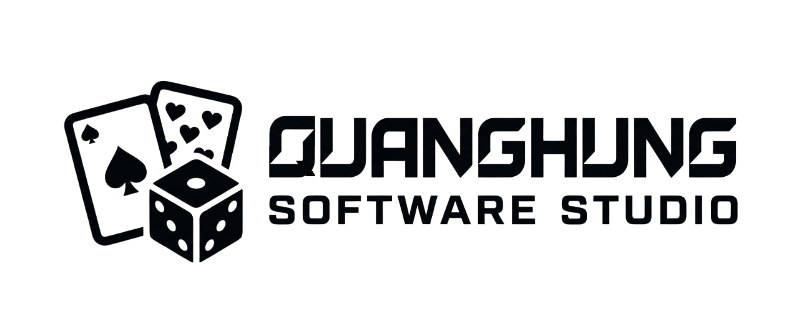
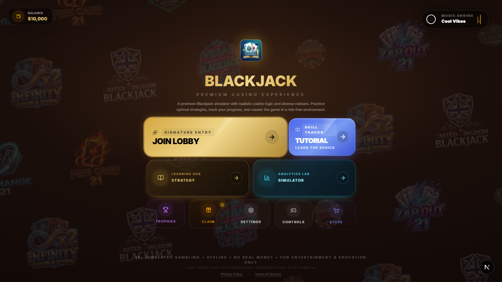
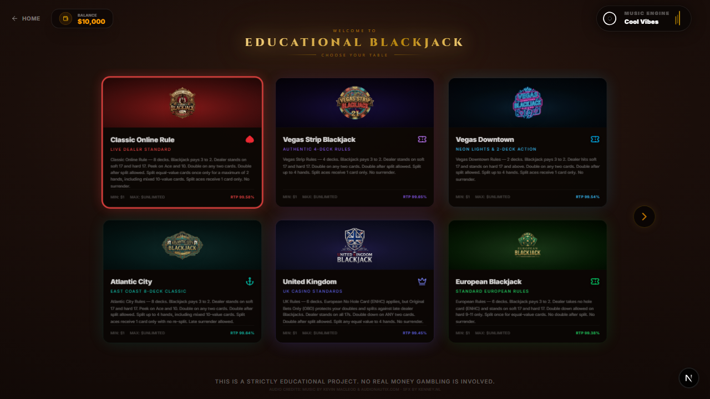
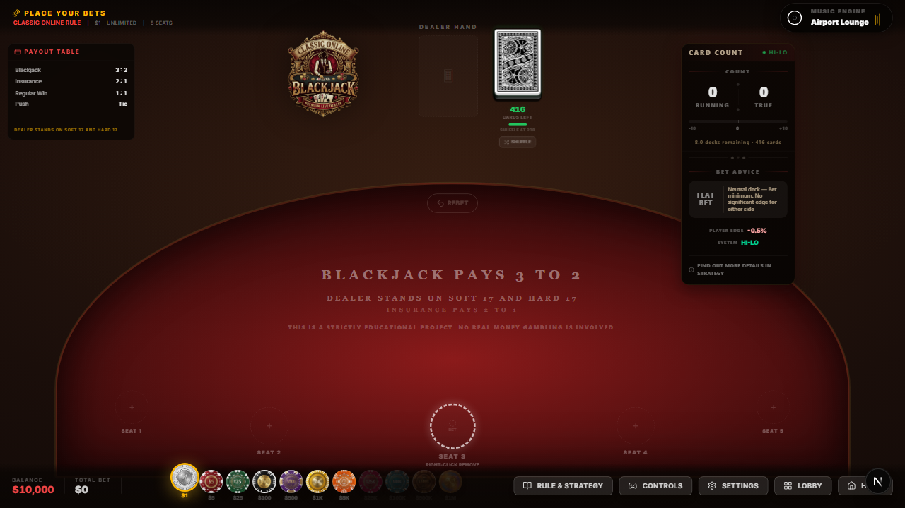
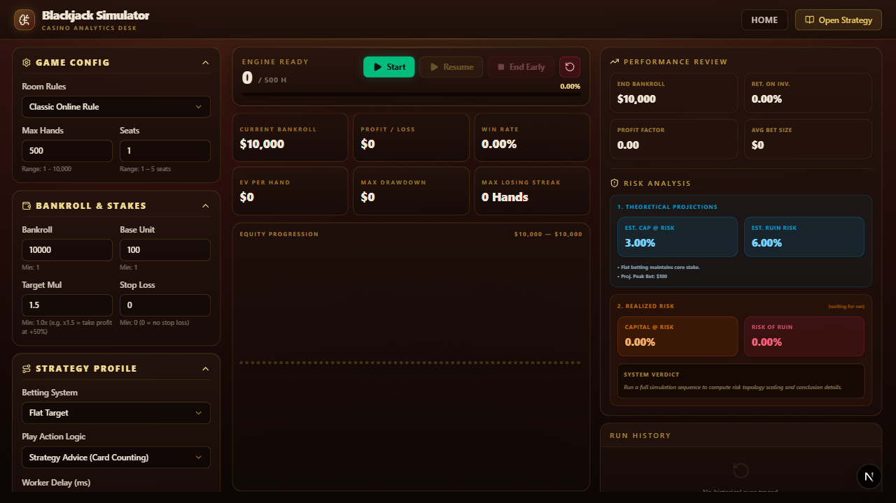

# Educational Blackjack — Web & Desktop (Next.js 16 + Tauri v2)

<p align="center">
  
</p>

A Blackjack game and strategy simulator I built to practice casino rule variations, basic strategy, and card counting without real-money risk. It runs both as a static web build (for itch.io) and as a native Windows/macOS/Linux desktop app wrapped with **Tauri v2 (Rust)**.

---

## Screenshots

### Main Menu & Learning Hub


### Casino Room Lobby (Rule Variations & RTP)


### Live Table with Running / True Hi-Lo Count & Bet Advice


### Strategy & Risk of Ruin Simulator


---

## What's Inside

* **Multiple Rule Variations (Strategy Pattern in `src/rules/`):** Supports Classic 8-Deck, Vegas Strip (4-Deck), Vegas Downtown (2-Deck), Atlantic City, European No-Hole-Card (ENHC), United Kingdom, plus custom bonus tables (*Push 22*, *Multi-Action*, *Zap Out 21*).
* **Real-Time Card Counting & Strategy Hints:** Tracks the running and true Hi-Lo count across the shoe, calculates live player edge, and suggests optimal hit/stand/double/split decisions.
* **Monte Carlo Strategy Simulator (`src/app/simulator/`):** Runs hundreds or thousands of hands in the background to measure win rate, expected value (EV) per hand, max drawdown, and estimated risk of ruin across different betting progressions.
* **Custom Procedural Card Decks:** Includes standard decks alongside custom themes (*Cyber Hacker*, *Frosted Glass*, and animated *Iridescent Rainbow* WebP cards generated via Python image-processing pipelines).
* **Cross-Platform Packaging:** Single codebase targeting both **itch.io HTML5** (`npm run build:itch`) and **Tauri v2 Desktop** (`npm run build:tauri`), with automated `.webm`/`.ogg` audio transcoding and Playwright screenshot capture.

---

## Tech Stack

* **Frontend:** Next.js 16 (App Router), React 19, TypeScript, Tailwind CSS v4
* **State & Animation:** Zustand v5 (persisted slices for game state, bankroll, and achievements), Framer Motion
* **Desktop Runtime:** Tauri v2 (Rust)
* **Tooling & Automation:** Playwright (automated screenshot pipeline), Python Pillow/NumPy (card asset generation), PowerShell/FFmpeg (audio compression)

---

## Running Locally

### Prerequisites
* **Node.js** 18+
* **Rust & Cargo** (only required if building the Tauri desktop window)

### Commands

```bash
# Clone the repo
git clone https://github.com/hungdonguyen/BlackJack-Education-App.git
cd BlackJack-Education-App

# Install dependencies
npm install

# Run in browser (http://localhost:3000)
npm run dev

# Run as a native desktop app via Tauri
npm run tauri dev
```

### Production Builds

```bash
# Build static web bundle for itch.io
npm run build:itch

# Build native desktop installer (.exe / .msi)
npm run tauri build
```

---

## License

MIT License. Built strictly for educational and simulation purposes — no real money or gambling is involved.
